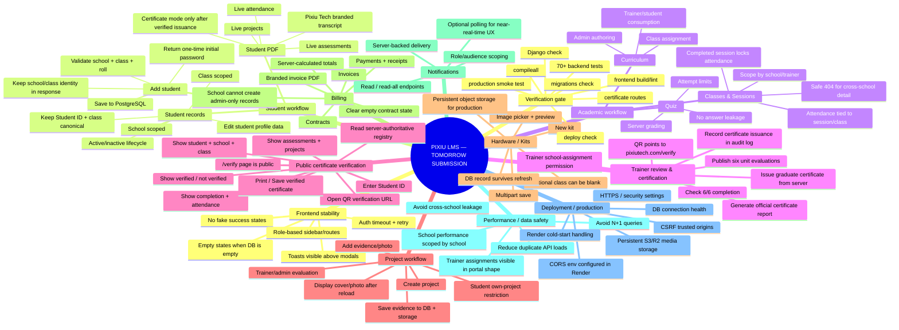

# Pixiu Tech LMS — School Submission Mind Map

## Submission gate

**Must be green before school demo:** login → role dashboard → add/edit student → create class/session → attendance → quiz → trainer review → certificate issue → QR `/verify` → project/evidence → billing/invoice PDF → kit image flow → notifications → reload and verify saved data.

**Known external checks:** Render/Vercel environment variables, deployed commit, live CORS/CSRF, persistent object storage and production smoke testing cannot be proven from repository source alone; verify these in the deployment dashboards before the live demo.
