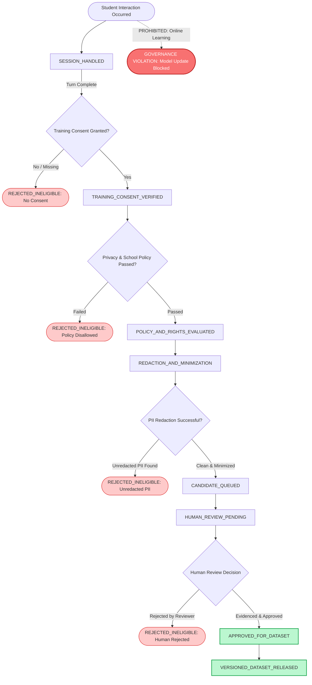

# PIXIU TECH AI COPILOT — PHASE 1E
## Data Lifecycle, Privacy Decision Record & State Diagram

**Document Type:** Architecture & Privacy Decision Record (Phase 1E Deliverable 3 & 4)  
**Target Milestone:** Pixiu AI Copilot Phase 1E (AI Tutor, Bilingual Response & Learning-Data Foundation)  
**Status:** Approved Engineering Baseline  
**Classification:** Internal / Proprietary — Pixiu Tech  

---

## 1. Executive Summary & Core Architectural Principle

Pixiu AI Copilot is an educational AI lab assistant designed for classroom and self-paced learning in physical computing, electronics, and science. Unlike open-ended consumer chatbots, educational systems operate under strict student privacy, pedagogical integrity, and safety boundaries.

### Core Architectural Principle
> **"The model proposes; Pixiu software validates; the student controls Apply; learning data remains governed."**

### Non-Negotiable Invariants
1. **The Model is Not the Validator:** An explanation or AI chat response is never proof that a circuit works or is safe.
2. **No Silent Canvas Mutation:** AI proposals must pass deterministic schema and electrical validation, render in visual preview (ghost state), and require explicit student confirmation before application.
3. **No Automatic Online Weight Updates:** Raw student chats, prompts, or feedback events **never** update model weights in real time. Model changes only occur via governed, versioned Phase 4/5 releases.
4. **Strict Concept Separation:** Session context, saved history, project memory, user preferences, and learning candidates are logically and physically separate data structures.

---

## 2. Separation of the 5 Core Data Concepts

To ensure maintainability, security, and student privacy, the architecture enforces strict boundaries across five distinct data models:

```
┌────────────────────────────────────────────────────────────────────────┐
│                        STUDENT WORKSPACE / LAB                         │
├──────────────────┬──────────────────┬──────────────────┬───────────────┤
│ Concept A:       │ Concept B:       │ Concept C:       │ Concept D:    │
│ Session Context  │ Saved History    │ Project Memory   │ Preferences   │
│ (Ephemeral)      │ (User Logs)      │ (Pinned Facts)   │ (Settings)    │
└────────┬─────────┴────────┬─────────┴────────┬─────────┴───────┬───────┘
         │                  │                  │                 │
         └──────────────────┼──────────────────┴─────────────────┘
                            ▼
              [ Explicit Training Consent ]
                            │
                            ▼
                     ┌──────────────┐
                     │ Concept E:   │
                     │ Learning     │
                     │ Candidates   │
                     │ (Governed)   │
                     └──────────────┘
```

### Concept A: Session Context
- **Purpose:** Ephemeral in-memory context required solely to answer the current prompt (e.g., active tab, selected breadboard components, current canvas revision hash, temporary token budget).
- **Lifecycle:** Created on turn start; discarded when turn/session terminates.
- **Boundary:** Never stored in persistent storage; never accessible outside the active session; never used for training.

### Concept B: Saved Conversation History
- **Purpose:** Preserves past question-and-answer interactions for student review, continuity across browser reloads, and teacher assistance.
- **Storage Condition:** Stored **only** when `historyRetentionConsent === true`.
- **Retention Options:** `session_only`, `30_days`, `90_days`, or `until_deleted`.
- **Boundary:** Storing history **does not** grant permission to use conversations for model training or evaluation.

### Concept C: Saved Project Memory
- **Purpose:** Stores specific, confirmed circuit and project milestones (e.g., "Ultrasonic distance alarm using Arduino Uno pin D9 and HC-SR04").
- **Boundary:** Project memory captures intentional milestone facts, not raw conversational noise. Separate from conversation transcripts.

### Concept D: Optional User Preferences
- **Purpose:** Persists student preferences across sessions (e.g., preferred language: `english` vs `hinglish`, explanation depth: `quick` vs `student` vs `deep_dive`, UI accessibility settings).
- **Boundary:** Independent settings schema; decoupled from conversation content and project state.

### Concept E: Learning-Data Candidates
- **Purpose:** Carefully curated interactions that may eventually be considered for inclusion in future versioned benchmark or training datasets.
- **Boundary:** A conversation record is **never** automatically a learning candidate. Requires explicit opt-in, policy evaluation, PII redaction, and independent human review.

---

## 3. Deliverable 4 — Prompt-to-Learning-Candidate State Diagram

The lifecycle from a raw student interaction to an approved, versioned dataset record is modeled as a strictly monotonic finite state machine. Any validation failure, missing consent, or policy issue routes immediately to the terminal sink `REJECTED_INELIGIBLE`.



---

## 4. Privacy, Deletion, Export & Audit Governance

### A. Data Deletion Protocol
When a student, school, or admin requests data deletion (`pixiu-privacy-deletion-v1`):
1. **Scope Selection:** The request specifies the target scope (`conversation_history`, `project_memory`, `learning_candidates`, or `all_student_data`).
2. **Immediate Invalidation:** Any unapproved learning candidates linked to the user are transitioned immediately to `REJECTED_INELIGIBLE` with reason `USER_DELETION_REQUESTED`.
3. **Storage Purge:** Persistent history and memory entries are scrubbed from the active database.
4. **Audit Record:** A cryptographically traceable audit log entry is recorded (`auditLogId`) containing timestamp, user reference hash, and affected record types, without storing the raw deleted content.

### B. Data Export Protocol
Students have the right to download their project data (`pixiu-privacy-export-v1`):
1. Exports encompass saved history, project memory facts, and user preferences in standard JSON or CSV formats.
2. Ephemeral session scratchpads and internal model telemetry envelopes are omitted to keep exports human-readable and clean.

### C. Access Control Boundaries
- All interaction and memory records enforce tenant isolation: records are bounded by `userId` and `projectId`.
- Cross-user data leakage is prevented at the schema query boundary.

---

## 5. Explicit Product & Privacy Decisions to Ratify

The following items are documented as engineering assumptions with conservative defaults, pending formal school district and business ratification:

| Area | Engineering Assumption (Phase 1E Default) | Requires Owner Ratification |
| :--- | :--- | :--- |
| **Default History Retention** | Unapproved policy; code defaults explicitly to `pending_owner_approval`. | School partner & privacy officer preference: `session_only` vs `until_deleted` vs explicit period. |
| **Minor / Student Consent** | Opt-in for learning candidates defaults to `false` (Strict Opt-In). | COPPA / FERPA / DPDP parental/guardian consent portal integration. |
| **Hinglish Vocabulary Scope** | Hinglish triggers based on Romanized Hindi keywords; technical terms remain standard English. | Curriculum team review for regional vernacular nuances. |
| **Data Storage Backend** | Schema-first interfaces ready for IndexedDB (client) and PostgreSQL/Redis (server). | Infrastructure hosting selection for multi-region schools. |

---

## 6. Student PII Sanitization Baseline, Fail-Closed Guarantees & Documented Limitations

### A. Sanitization Capabilities & Scope
The Phase 1E deterministic sanitizer (`scrubPii()`) scrubs eight categories of structured identifiers prior to queueing learning candidates:
1. **Email Addresses:** Standard local and domain formats (`[REDACTED_EMAIL]`).
2. **Phone Numbers:** Indian 10-digit mobile and US/international formatted numbers (`[REDACTED_PHONE]`).
3. **Authentication Secrets:** Bearer tokens, API keys, passwords (`[REDACTED_SECRET]`).
4. **Government / National IDs:** Indian 12-digit Aadhaar (4-4-4 format), US Social Security Numbers (`[REDACTED_GOV_ID]`).
5. **Student Roll & Admission IDs:** Explicit roll numbers, registration, and school admission codes (`[REDACTED_STUDENT_ID]`).
6. **Class, Grade & Section:** Class designations (e.g. `Class 8B`, `Grade 10`, `Standard IX`) (`[REDACTED_CLASS]`).
7. **School Names:** Recognized educational suffixes and school prefixes (`Delhi Public School`, `Kendriya Vidyalaya`, `High School`, `Vidyalaya`) (`[REDACTED_SCHOOL]`).
8. **Student Name Self-Disclosures:** Explicit conversational introductions (`My name is Aarav Sharma`, `I am Priya Patel`) (`[REDACTED_STUDENT_NAME]`).

### B. Fail-Closed Guarantees & Multi-Tier Field Verification
1. **Validation of Every Candidate Text Field:** Every incoming field that can enter a learning candidate—specifically both `redactedPrompt` and `redactedResponseSummary`, as well as reviewer `evidenceNotes`—is strictly validated and sanitized. If any text field contains unredacted PII or potential student identity markers, the candidate immediately fails closed into `REJECTED_INELIGIBLE`.
2. **Caller Flag Skepticism:** Caller-provided flags (`isRedacted: true`, `piiDetected: false`, `piiTypes: []`) are never blindly trusted. If a caller submits raw PII while claiming `isRedacted: true`, the state machine rejects it. Furthermore, `piiDetected` and `piiTypes` are truthfully derived from system-level inspection, preventing spoofed metadata.
3. **Multi-Signal Identity Leakage Heuristics:**
   - **Interpersonal Dialogue Detection:** Detects narrative markers (`told`, `asked`, `says`, `said`, `informed`, `classmate`, `friend`, `brother`, etc.).
   - **Unfamiliar & Informal Schools:** Detects regional or unlisted institutions (`from greenwood`, `at riverdale`).
   - **Informal Student IDs:** Detects informal numbering schemes (`my id is 4021`, `roll is 12`, `#3091`).
   - **Capitalized Non-Technical Proper Nouns:** Cross-references non-technical words against a comprehensive STEM whitelist to catch natural conversational names (e.g., *"Aarav Sharma told Rahul that his Arduino LED stopped working"*).
4. **State-Machine Boundary Intake Policy Enforcement & Immutability:** Until reliable student-identity screening (e.g., local NER) and authoritative district consent verification are available, free-text learning candidate intake is strictly disabled by default (`isLearningDataIntakeEnabled() === false`). The configuration `DEFAULT_LEARNING_DATA_INTAKE_CONFIG` is deeply frozen (`Object.freeze()`) and immutable. This policy is enforced at the state-machine transition boundary independently of whether the caller provides `rawPrompt`, pre-filled `redactionResult`, or fabricated candidate state objects: transitions to `CANDIDATE_QUEUED`, `HUMAN_REVIEW_PENDING`, and `VERSIONED_DATASET_RELEASED` unconditionally fail closed with `REJECTED_LEARNING_DATA_INTAKE_DISABLED`. No caller-controlled boolean, verifier, environment variable, or mock bypass exists.
5. **Zero Raw Prompt Leakage:** Raw student input is never assigned to candidate records, review queues, audit logs, or error strings. Rejection reasons are sanitized constants.
6. **Normal Tutoring Independence:** Failure to qualify a prompt or rejection of training candidate intake strictly does not abort or interrupt the active student tutoring turn. The student receives immediate, validated educational assistance regardless of training candidate rejection.

### C. Documented Limitations & Phase 4 Roadmap
Regex pattern matching and lexical heuristics provide a strong deterministic baseline defense, but do not replace full natural-language named entity recognition:
1. **Conservative Free-Text Intake Policy:** Because regex cannot guarantee detection of all names and contextual identity in unconstrained natural prose, free-text candidate intake is locked in an immutable disabled-by-default state (`REJECTED_LEARNING_DATA_INTAKE_DISABLED`). No fake identity-detection success is claimed. Full semantic entity screening requires an on-device/private NER model scheduled for Phase 4.
2. **Authoritative Reviewer & Consent Verifier (Zero Test-Mock Artifacts in Production):** Caller-controlled booleans (`trainingConsent: true`), caller-supplied consent records (`verificationStatus: "VERIFIED_ACTIVE"`), and caller-injected verifier functions (`reviewerVerifier: () => ({ verified: true })`) are strictly forbidden and fail closed (`REJECTED_CALLER_CONTROLLED_CONSENT_FORBIDDEN`, `REJECTED_UNVERIFIED_CONSENT_AUTHORITY`, `REJECTED_CALLER_INJECTED_VERIFIER_FORBIDDEN`). All test-mock authorization mechanisms (`__testOnly_mockAuthorization`) have been completely purged from the production API. Dataset approval unconditionally fails closed (`REJECTED_AUTHORITATIVE_VERIFIER_UNAVAILABLE`) until authoritative district consent portal and server-side IAM/SSO integrations are delivered in Phase 4.
3. **Retention Policy Ratification:** Default retention remains locked at `pending_owner_approval` until ratified by the school administration and privacy officer.

---

*Authored by Antigravity Engineering for Pixiu Tech AI Copilot.*
